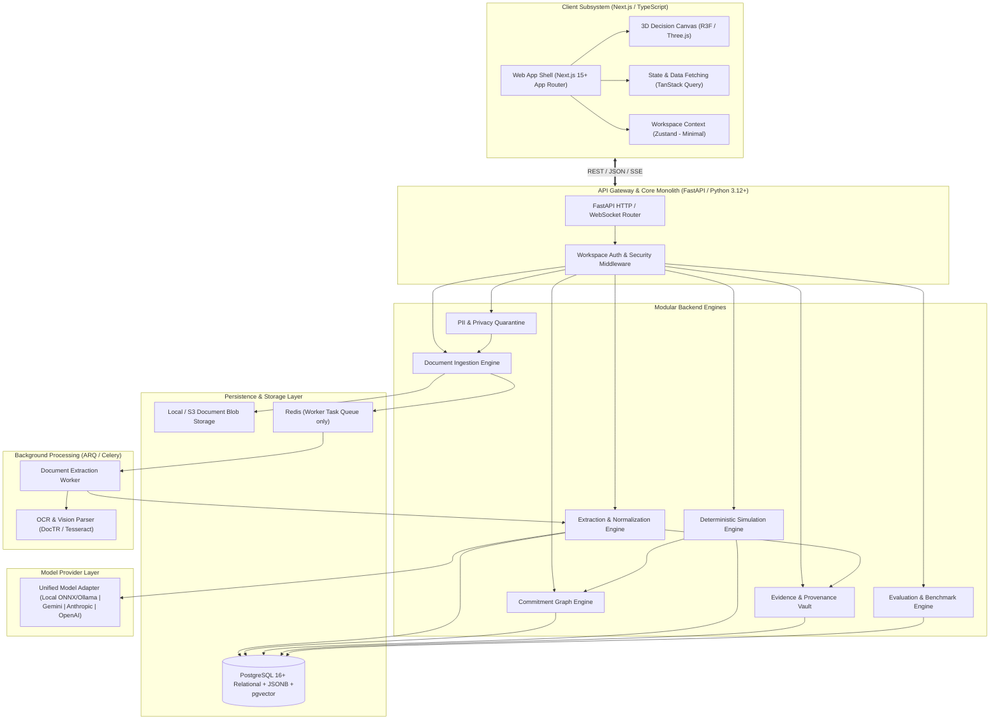
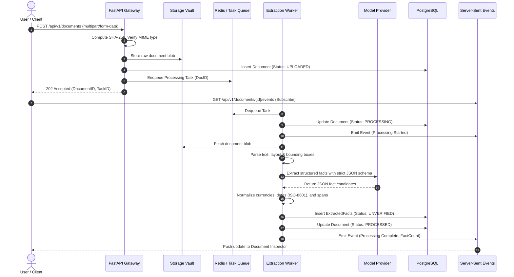

# AFTERMATH — System Architecture Specification
**Document Version:** 1.0.0  
**Status:** Approved Architectural Blueprint  
**Classification:** Core Technical Specification  

---

## 1. Architectural Philosophy & Guiding Principles

AFTERMATH is architected as a **disciplined modular monolith**. We explicitly reject microservice sprawl: microservices introduce distributed transaction failure modes, deployment complexity, latency overhead, and operational friction that are toxic to a fast-moving, high-integrity product.

### Core Architectural Invariants
1. **Modular Monolith First:** Distinct domain boundaries enforced through Python package hierarchies and internal service interfaces. No network hops between internal modules.
2. **Strict Separation of Concerns:**
   * **Ingestion** is isolated from **Extraction**.
   * **Extraction** is isolated from **Simulation**.
   * **Deterministic Simulation** is strictly separated from **Probabilistic AI Interpretation**.
3. **Evidence Immutability:** Any assertion produced by the system must retain an unbroken, cryptographically verifiable pointer back to the exact source artifact.
4. **Zero Untrusted Execution:** Uploaded files are treated as hostile binary blobs. They are never executed, rendered in un-sandboxed contexts, or evaluated dynamically.
5. **No Invented Metrics:** No composite "Safety Score" or "Risk Index" unless computed deterministically from verified breach conditions.

---

## 2. High-Level System Architecture Diagram



---

## 3. Technology Stack Selection & Rationales

### 3.1 Frontend Stack
* **Framework:** Next.js (App Router, React 19, TypeScript).
  * *Rationale:* Server-side rendering for marketing/landing pages, client-side React Server Components (RSC) for zero-bundle data views, strict TypeScript compilation for domain types.
* **Styling:** Vanilla CSS + Tailwind CSS v3/v4.
  * *Rationale:* Tailwind provides disciplined design tokens (spacing, typography, color palettes) without runtime CSS-in-JS overhead. Strict constraint: no arbitrary utility sprawl; tokens are locked to the AFTERMATH design system.
* **Visualization & 3D:** Three.js, React Three Fiber (R3F), Motion (Framer Motion).
  * *Rationale:* Three.js is used strictly for information visualization (abstract decision-space geometry, interactive commitment planes, branch paths). Motion handles accessible DOM micro-transitions.
* **State Management:** URL Query Parameters (primary state) + TanStack Query (server cache) + Zustand (client-only workspace UI toggles).
  * *Rationale:* Avoids massive global stores. URLs remain the single source of truth for filters, selected documents, scenario IDs, and node selections.

### 3.2 Backend Stack
* **Language & Framework:** Python 3.12+ with FastAPI.
  * *Rationale:* Native support for modern asynchronous I/O (`asyncio`), high-performance Pydantic v2 serialization, first-class ecosystem for document parsing, NLP, mathematical graph modeling, and AI model orchestration.
* **Data Modeling & Validation:** Pydantic v2.
  * *Rationale:* Rigorous schema validation at all network and inter-module boundaries. Pydantic v2's Rust core delivers high parsing throughput.
* **ORM & Database Toolkit:** SQLAlchemy 2.0 (Async) + Alembic.
  * *Rationale:* Clean decoupling of relational schema definition from query execution; full support for PostgreSQL advanced types (JSONB, UUID, native arrays, recursive CTEs).

---

## 4. Database Strategy: PostgreSQL vs. MySQL Comprehensive Analysis

To select the persistence foundation, we evaluated PostgreSQL against MySQL across six critical technical dimensions:

| Evaluation Dimension | PostgreSQL 16+ | MySQL 8.0+ | Winner & Technical Justification |
| :--- | :--- | :--- | :--- |
| **JSON Handling & Semi-Structured Data** | Native binary `JSONB`, GIN indexes, JSONPath expressions (`jsonb_path_query`), containment operators (`@>`, `?&`). | Functional `JSON` type, basic indexed virtual columns. Lacks native inverted index for flexible nested querying. | **PostgreSQL**: Vital for variable commitment clauses, custom scenario parameters, and raw parser AST outputs. |
| **Graph & Dependency Traversal** | High-performance Recursive Common Table Expressions (`WITH RECURSIVE`), cycle detection (`CYCLE clause`), optimized plan caching. | Supports recursive CTEs but lacks native cycle detection and has higher memory overhead on deep trees. | **PostgreSQL**: Crucial for traversing multi-hop commitment dependency graphs and consequence chains. |
| **Integrity & Advanced Constraints** | Deferrable foreign keys, CHECK constraints with regex, Table-level EXCLUSION constraints (e.g., preventing temporal overlaps). | Foreign keys and basic CHECK constraints. No native EXCLUSION constraints for non-overlapping temporal ranges. | **PostgreSQL**: Enables database-level guarantees that a user cannot have conflicting exclusive obligations active simultaneously. |
| **Extensibility & Vector Future** | In-database vector similarity via `pgvector`, domain extensions, custom procedural types. | Basic vector functions in 8.4+, but less mature ecosystem and ecosystem tooling. | **PostgreSQL**: Allows unified semantic retrieval without introducing an external vector database. |
| **Async Python Driver Ecosystem** | `asyncpg` is the fastest async database driver in the Python ecosystem. | `aiomysql` / `asyncmy` have lower throughput and feature lag. | **PostgreSQL**: Exceptional performance with SQLAlchemy 2.0 async engine. |
| **Local Development & Tooling** | Single Docker container, identical behavior across dev, CI, and production. | Single Docker container, but slight collation and mode quirks across platforms. | **PostgreSQL**: Absolute predictability across environments. |

### Decision
**PostgreSQL 16+ is selected as the primary and only relational/document database.**

---

## 5. Supporting Infrastructure: Redis & Task Queue

Redis is **not** introduced prematurely as a generic cache. It is introduced with a single, tightly scoped responsibility:
1. **Background Job Queue:** Managing asynchronous document processing jobs (PDF OCR, layout analysis, LLM extraction pipelines) via a lightweight, typed task runner (`ARQ` or `Celery`).
2. **Ephemeral Simulation Buffer:** Caching computationally heavy, deterministic Monte Carlo or branch-expansion graphs during an active user scenario session (TTL: 1 hour).

If a single-node deployment does not require background distributed workers initially, the task queue defaults to an in-memory/asyncio worker pool, ensuring the system can run with zero dependencies beyond PostgreSQL.

---

## 6. Modular Boundaries & Internal APIs

The backend is partitioned into seven decoupled internal modules:

```
src/aftermath/
├── api/                   # FastAPI route controllers, dependency injection
├── ingestion/             # Document parsers, format normalizers, hash verification
├── extraction/            # Fact extractors, layout analyzers, LLM adapters, HITL verification
├── commitments/           # Domain entity ledger, state management, obligation tracker
├── graph/                 # Dependency graph construction, cycle detection, topological sort
├── simulation/            # Discrete event engine, counterfactual evaluator, rule checks
├── evidence/              # Source span locator, cryptographic hashing, provenance auditor
├── privacy/               # PII masking, local quarantine, data retention enforcer
└── evaluation/            # Ground truth benchmarks, precision/recall scoring
```

### Module Boundary Invariants
* **`api`** may import all module service interfaces.
* **`ingestion`** has no dependencies on `extraction` or `simulation`. It produces raw `DocumentArtifact` and `PageText` objects.
* **`extraction`** consumes `DocumentArtifact` and produces `ExtractedFact` objects linked to `SourceSpan`. It does not know how commitments are simulated.
* **`commitments`** consumes verified `ExtractedFact` objects and constructs canonical `Commitment`, `Obligation`, and `Deadline` entities.
* **`graph`** constructs directed acyclic or cyclic graphs from commitments and their dependencies.
* **`simulation`** operates purely on the graph and scenario variables. It is deterministic and has no direct dependence on external AI APIs.
* **`evidence`** validates and resolves any entity's provenance.

---

## 7. Network, Event Flow & Asynchronous Processing

### Document Processing Lifecycle


---

## 8. Deployment & Environment Strategy

* **Local Development:** Single command launch via `docker-compose.yml` defining:
  * `web`: Next.js development server
  * `api`: FastAPI hot-reloading server
  * `db`: PostgreSQL 16 with pgvector extension enabled
  * `redis`: Redis 7 alpine
* **Continuous Integration:** GitHub Actions executing:
  1. Frontend ESLint + TypeScript typecheck (`tsc --noEmit`)
  2. Backend Ruff (lint + format check) + MyPy (strict typecheck)
  3. Backend Pytest suite (unit + integration with ephemeral test DB)
  4. Alembic migration verification (`alembic upgrade head`)
  5. Frontend Vitest unit test suite + Next.js build validation
* **Production Deployment Options:**
  * Self-Hosted / Single Node: Docker Compose or single binary container.
  * Cloud Native: Containerized ECS / Cloud Run / Kubernetes deployment with managed PostgreSQL.
