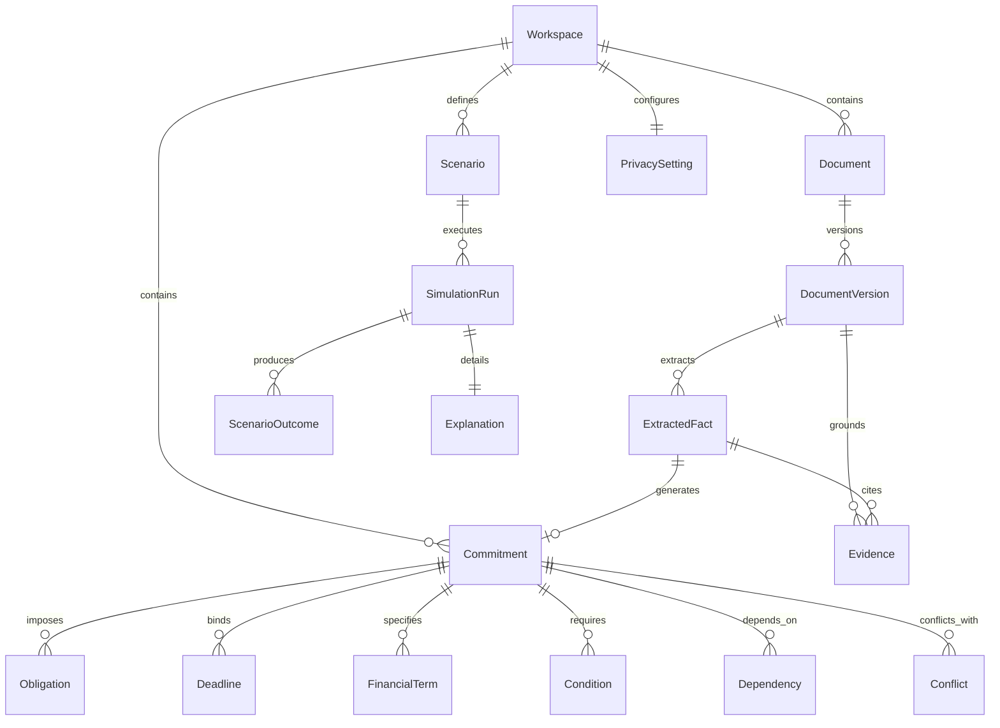

# AFTERMATH — Domain Model Specification
**Document Version:** 1.0.0  
**Status:** Approved Architectural Blueprint  
**Classification:** Core Domain Modeling  

---

## 1. Domain Philosophy: Human Decisions, Not Enterprise Software

AFTERMATH models commitments in the **human-decision domain**. A commitment is not a static database record; it is a live, conditional, temporal covenant made by a human being or organization, carrying obligations, liabilities, dependencies, and exit constraints.

Unlike an ERP or project management tool, AFTERMATH must model:
* **Asymmetric Power:** Terms dictated unilaterally (leases, employment agreements, terms of service).
* **Conditional Triggers:** Penalties that lie dormant until a threshold is crossed (e.g., late fees, lease default acceleration).
* **Cross-Commitment Friction:** How an obligation in Document A (e.g., an in-office attendance clause) directly collides with an obligation in Document B (e.g., a child care agreement or geographic lease requirement).
* **Uncertainty & Ambiguity:** Clauses where legal meaning depends on disputed jurisdictional interpretation.

---

## 2. Comprehensive Entity Dictionary

The domain model specifies exactly 22 domain entities. Below is their precise conceptual definition, attributes, invariants, and storage justification.

```
+--------------------------------------------------------------------------------------------------+
|                                    DOMAIN ENTITY TOPOLOGY                                        |
+-----------------------------------+----------------------------------+---------------------------+
| Core Identity & Boundary          | Fact & Extraction Layer          | Commitment Graph          |
|  - User                           |  - Document                      |  - Commitment             |
|  - Workspace                      |  - DocumentVersion               |  - Obligation             |
|  - PrivacySetting                 |  - Source                        |  - Condition              |
|                                   |  - ExtractedFact                 |  - Deadline               |
|                                   |                                  |  - FinancialTerm          |
|                                   |                                  |  - Dependency             |
|                                   |                                  |  - Conflict               |
+-----------------------------------+----------------------------------+---------------------------+
| Simulation & Scenarios            | Provenance & Epistemics          | System & Operations       |
|  - Scenario                       |  - Evidence                      |  - Model                  |
|  - ScenarioVariable               |  - Explanation                   |  - EvaluationRun          |
|  - ScenarioOutcome                |                                  |                           |
|  - SimulationRun                  |                                  |                           |
+-----------------------------------+----------------------------------+---------------------------+
```

### 2.1 Entity Specifications

#### 1. `User`
* **Definition:** The human agent operating the platform.
* **Attributes:** `id`, `email`, `created_at`, `locale`, `timezone`.
* **Storage Justification:** Primary Relational Table (`users`). Needs hard relational integrity and auth foreign keys.

#### 2. `Workspace`
* **Definition:** An isolated context containing commitments, documents, and simulations (e.g., "Personal / Relocation 2026", "Consulting LLC").
* **Attributes:** `id`, `owner_user_id`, `name`, `slug`, `created_at`.
* **Storage Justification:** Primary Relational Table (`workspaces`). Strict multi-tenant isolation anchor.

#### 3. `PrivacySetting`
* **Definition:** Security, redaction, and data retention preferences governing a workspace.
* **Attributes:** `workspace_id`, `local_processing_only`, `mask_pii_before_llm`, `retention_days`, `allow_telemetry`.
* **Storage Justification:** Relational Table (`privacy_settings`) with 1:1 workspace relationship. Enforces database-level cascading policies.

#### 4. `Document`
* **Definition:** A logical commitment agreement (e.g., "Downtown Apartment Lease").
* **Attributes:** `id`, `workspace_id`, `title`, `domain_category`, `current_version_id`, `created_at`.
* **Storage Justification:** Primary Relational Table (`documents`). Relational anchor for version histories.

#### 5. `DocumentVersion`
* **Definition:** An immutable binary revision of a document (e.g., original draft, counter-offer, signed copy).
* **Attributes:** `id`, `document_id`, `version_number`, `file_name`, `mime_type`, `file_size_bytes`, `sha256_hash`, `storage_path`, `processing_status`, `error_message`, `created_at`.
* **Storage Justification:** Primary Relational Table (`document_versions`). Relational integrity prevents tampering or loss of historical versions.

#### 6. `Source`
* **Definition:** The physical or digital origin of a document version (e.g., scanned PDF, DocuSign export, email text).
* **Attributes:** `id`, `document_version_id`, `source_type` (`FILE_UPLOAD`, `EMAIL_FORWARD`, `MANUAL_ENTRY`), `metadata_json`.
* **Storage Justification:** Embedded within `document_versions` table as structured metadata to eliminate an unnecessary single-row join.

#### 7. `ExtractedFact`
* **Definition:** An atomic, discrete proposition extracted from a document version with exact textual grounding.
* **Attributes:** `id`, `document_version_id`, `fact_key`, `raw_value`, `normalized_value_json`, `data_type`, `epistemic_tier`, `confidence_score`, `extraction_method` (`REGEX`, `LAYOUT_PARSER`, `LLM_STRUCTURED`), `verification_status` (`UNVERIFIED`, `VERIFIED`, `EDITED`, `REJECTED`), `verified_by_user_id`, `verified_at`.
* **Storage Justification:** Primary Relational Table (`extracted_facts`). Core unit of querying, human-in-the-loop audit, and fact-level verification.

#### 8. `Commitment`
* **Definition:** A binding legal, financial, or operational agreement established between two or more parties.
* **Attributes:** `id`, `workspace_id`, `origin_document_version_id`, `title`, `counterparty_name`, `effective_date`, `expiration_date`, `status` (`DRAFT`, `ACTIVE`, `FULFILLED`, `TERMINATED`, `SUPERSEDED`, `BREACHED`), `governing_jurisdiction`.
* **Storage Justification:** Primary Relational Table (`commitments`). Central hub of the domain model.

#### 9. `Obligation`
* **Definition:** A specific mandatory, conditional, or prohibited duty imposed on a designated party.
* **Attributes:** `id`, `commitment_id`, `duty_bearer` (`SELF`, `COUNTERPARTY`, `THIRD_PARTY`), `modality` (`MANDATORY`, `PROHIBITED`, `OPTIONAL`), `description`, `trigger_event`, `remedy_on_breach`.
* **Storage Justification:** Primary Relational Table (`obligations`). Queried frequently for active tasks and compliance tracking.

#### 10. `Condition`
* **Definition:** A logical predicate or gating clause that must be satisfied for an obligation, right, or penalty to activate.
* **Attributes:** `id`, `commitment_id`, `expression_logic`, `is_satisfied`, `evaluation_type` (`DETERMINISTIC_DATE`, `USER_ASSERTION`, `EXTERNAL_TRIGGER`).
* **Storage Justification:** Embedded JSONB within `obligations` or relational table (`conditions`) for complex multi-party conditional chains. We store as a normalized table to enable cross-commitment dependency joins.

#### 11. `Deadline`
* **Definition:** A temporal boundary, recurring cycle, or notice window governing an obligation or right.
* **Attributes:** `id`, `commitment_id`, `obligation_id`, `title`, `deadline_type` (`ABSOLUTE_DATE`, `RELATIVE_DAYS`, `RECURRING_WINDOW`), `target_timestamp`, `relative_offset_days`, `relative_to_event`, `criticality` (`HIGH`, `MEDIUM`, `LOW`).
* **Storage Justification:** Primary Relational Table (`deadlines`). Must be indexed on `target_timestamp` for timeline projections and notification alerts.

#### 12. `FinancialTerm`
* **Definition:** Any monetary liability, asset transfer, escrow deposit, recurring charge, or penalty schedule.
* **Attributes:** `id`, `commitment_id`, `obligation_id`, `term_type` (`RECURRING_PAYMENT`, `SECURITY_DEPOSIT`, `PENALTY_FEE`, `INDEMNITY_CAP`, `REIMBURSEMENT`), `amount`, `currency` (ISO 4217), `frequency` (`MONTHLY`, `ANNUAL`, `ONE_TIME`, `PER_OCCURRENCE`), `escalation_rate_pct`.
* **Storage Justification:** Primary Relational Table (`financial_terms`). Indexed on `amount` and `currency` for financial simulation and budget aggregation.

#### 13. `Dependency`
* **Definition:** A directed causal or procedural edge linking two domain entities (e.g., Commitment B depends on Commitment A; Obligation Y depends on Condition X).
* **Attributes:** `id`, `source_entity_type`, `source_entity_id`, `target_entity_type`, `target_entity_id`, `dependency_type` (`PREREQUISITE`, `CAUSAL_CONSEQUENCE`, `SUPERSEDES`, `RESTRICTED_BY`).
* **Storage Justification:** Primary Relational Table (`dependencies`). Queried with Recursive CTEs for graph traversal and topological sorting.

#### 14. `Conflict`
* **Definition:** An identified structural, temporal, or legal contradiction between two commitments or obligations.
* **Attributes:** `id`, `workspace_id`, `commitment_a_id`, `commitment_b_id`, `conflict_type` (`EXCLUSIVE_TIME_OVERLAP`, `NON_COMPETE_VIOLATION`, `FINANCIAL_CAPACITY_DEFICIT`, `CONTRADICTORY_DUTY`), `severity` (`BLOCKING`, `WARNING`, `ADVISORY`), `resolution_status` (`OPEN`, `ACKNOWLEDGED`, `RESOLVED`).
* **Storage Justification:** Primary Relational Table (`conflicts`). Essential for cross-document conflict visualization and alert badges.

#### 15. `Scenario`
* **Definition:** A user-configured counterfactual simulation environment representing a hypothetical choice or life event.
* **Attributes:** `id`, `workspace_id`, `title`, `description`, `baseline_snapshot_at`, `created_at`.
* **Storage Justification:** Primary Relational Table (`scenarios`). Persists named scenarios for comparison (e.g., "Resign in June" vs "Stay until Equity Cliff").

#### 16. `ScenarioVariable`
* **Definition:** A specific state perturbation or override applied to a baseline commitment fact within a scenario.
* **Attributes:** `scenario_id`, `target_entity_id`, `variable_key`, `override_value_json`, `effective_date`.
* **Storage Justification:** Embedded JSONB array inside the `scenarios` table (`variables` column). Rationale: Variables only exist in the context of their parent scenario and are always loaded together.

#### 17. `ScenarioOutcome`
* **Definition:** The computed downstream impact of running a scenario (financial total, broken obligations, penalties incurred).
* **Attributes:** `simulation_run_id`, `outcome_type` (`FINANCIAL_DELTA`, `BREACH_TRIGGERED`, `DEADLINE_MODIFIED`, `RESIDUAL_LIABILITY`), `summary`, `delta_amount`, `impact_details_json`.
* **Storage Justification:** Stored as structured JSONB within `simulation_runs` table. Rationale: Ephemeral snapshot tied exclusively to a specific simulation execution.

#### 18. `Evidence`
* **Definition:** The cryptographically verified citation linking a fact or assertion to a physical text span.
* **Attributes:** `id`, `extracted_fact_id`, `document_version_id`, `page_number`, `char_start`, `char_end`, `bounding_box_json`, `verbatim_text`.
* **Storage Justification:** Primary Relational Table (`evidence_records`). Enables direct high-speed spatial lookup from UI coordinates to source documents.

#### 19. `Explanation`
* **Definition:** A deterministic, step-by-step causal chain detailing why a simulation outcome or conflict occurred.
* **Attributes:** `id`, `simulation_run_id` or `conflict_id`, `reasoning_steps_json` (array of step, rule, cited_fact_id, cited_evidence_id), `generated_at`.
* **Storage Justification:** Embedded JSONB within the parent `simulation_runs` or `conflicts` record. Rationale: Explanations are immutable audit traces tied to a specific execution run.

#### 20. `SimulationRun`
* **Definition:** The execution instance of a scenario evaluated against the commitment graph.
* **Attributes:** `id`, `scenario_id`, `executed_at`, `execution_duration_ms`, `engine_version`, `status` (`COMPLETED`, `FAILED`), `outcomes_json`, `explanation_json`.
* **Storage Justification:** Primary Relational Table (`simulation_runs`). Enables historical comparison of different runs over time.

#### 21. `Model`
* **Definition:** Metadata describing the AI model or parser engine version utilized in an extraction or simulation run.
* **Attributes:** `id`, `provider` (`LOCAL_ONNX`, `GOOGLE_GEMINI`, `ANTHROPIC`, `OPENAI`), `model_name`, `parameters_hash`, `prompt_template_version`.
* **Storage Justification:** Normalized Relational Table (`ai_models`). Guarantees reproducibility and provenance across model upgrades.

#### 22. `EvaluationRun`
* **Definition:** A benchmark test measuring extraction precision, recall, and hallucination rates against a verified golden dataset.
* **Attributes:** `id`, `model_id`, `dataset_name`, `total_samples`, `exact_match_score`, `precision_score`, `recall_score`, `hallucination_count`, `run_at`.
* **Storage Justification:** Relational Table (`evaluation_runs`). Powers the `/evaluation` dashboard with real, non-fabricated metrics.

---

## 3. Storage Strategy Summary: Table vs. JSONB vs. In-Memory

```
+--------------------------------------------------------------------------------------------------+
|                                    STORAGE ALLOCATION MATRIX                                     |
+-----------------------------------+-----------------------------------+--------------------------+
| Relational Tables (PostgreSQL)    | Embedded JSONB Columns            | In-Memory Ephemeral Data |
+-----------------------------------+-----------------------------------+--------------------------+
| users                             | scenario_variables (in scenarios) | NetworkX Graph Instances |
| workspaces                        | outcomes_json (in simulation_runs)| Simulation Event Priority|
| privacy_settings                  | explanation_json (in sim_runs)    | Queue during simulation  |
| documents                         | bounding_box_json (in evidence)   | Transient Parser AST     |
| document_versions                 | normalized_value_json (in facts)  | Memory Layout Cache      |
| extracted_facts                   | metadata_json (in doc_versions)   | Active SSE Connection    |
| commitments                       |                                   | State                    |
| obligations                       |                                   |                          |
| conditions                        |                                   |                          |
| deadlines                         |                                   |                          |
| financial_terms                   |                                   |                          |
| dependencies                      |                                   |                          |
| conflicts                         |                                   |                          |
| scenarios                         |                                   |                          |
| simulation_runs                   |                                   |                          |
| evidence_records                  |                                   |                          |
| ai_models                         |                                   |                          |
| evaluation_runs                   |                                   |                          |
+-----------------------------------+-----------------------------------+--------------------------+
```

---

## 4. Domain Relationships & Cardinalities



---

## 5. Domain State Machines

### 5.1 Document Version Processing State Machine
```
[UPLOADED] ───(Worker Picks Up)───► [PROCESSING]
                                        │
                    ┌───────────────────┴───────────────────┐
                    ▼                                       ▼
               [PROCESSED]                              [FAILED]
         (Facts Extracted Ready)              (Parse / Decryption Error)
```

### 5.2 Extracted Fact Verification State Machine
```
[UNVERIFIED] ───(User Reviews)───► [VERIFIED]   (Accepted verbatim)
      │
      ├───(User Corrects)────────► [EDITED]     (User overrides normalized value)
      │
      └───(User Discards)────────► [REJECTED]   (Excluded from commitment graph)
```

### 5.3 Commitment Lifecycle State Machine
```
[DRAFT] ───(Activated by Date)───► [ACTIVE]
                                      │
            ┌─────────────────────────┼─────────────────────────┐
            ▼                         ▼                         ▼
       [FULFILLED]               [TERMINATED]              [BREACHED]
    (Terms Complete)          (Early Cancellation)     (Default Condition Met)
```
